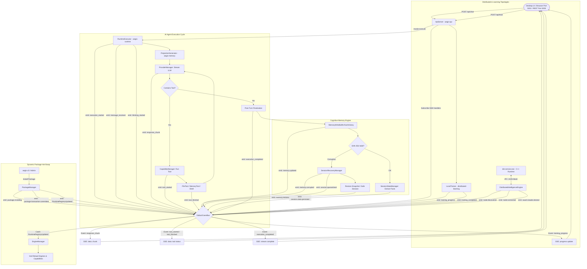
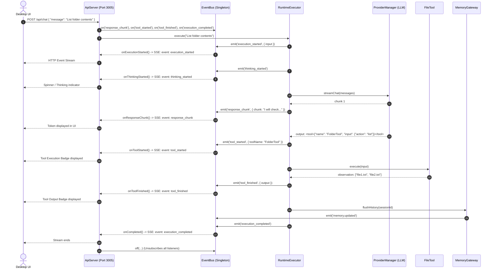

# AEGIS EventBus Cross-Engine Architecture & Flowchart

**Document Version:** 1.0.0  
**Target Systems:** `@aegis/runtime`, `@aegis/memory`, `@aegis/agent`, `@aegis/api`, `@aegis/distributed-intelligence`, `@aegis-training-engine`, `@aegis-package-manager`  
**Last Updated:** October 2026  

---

## 1. System Topology Overview

The AEGIS **EventBus** ([`packages/aegis-runtime/src/eventbus/EventBus.ts`](file:///c:/aegis/packages/aegis-runtime/src/eventbus/EventBus.ts)) is a strongly typed, decoupled publish-subscribe messaging nervous system that unifies all 15 platform engines, native C++ runtimes, and external client gateways without introducing tight compile-time coupling.

```
┌────────────────────────────────────────────────────────────────────────────────────────────────────────┐
│                                       GLOBAL EVENT BUS SINGLETON                                       │
│                                           (eventBus / EventEmitter)                                    │
└───────────────────────────────────────────────────┬────────────────────────────────────────────────────┘
        ▲                                ▲          │          ▲                          ▲
        │ Emits                          │ Emits    │ Dispatches                          │ Emits &
        │ Events                         │ Events   │ to Handlers                         │ Subscribes
        ▼                                ▼          ▼          ▼                          ▼
┌──────────────────┐             ┌───────────────┐ ┌───────────────┐             ┌──────────────────────┐
│  AI AGENT ENGINE │             │ MEMORY ENGINE │ │ REST API GW   │             │ DISTRIBUTED RUNTIME  │
│  (`aegis-agent`) │             │(`aegis-memory`)│ │ (`aegis-api`) │             │ (DIE / Native C++)   │
├──────────────────┤             ├───────────────┤ ├───────────────┤             ├──────────────────────┤
│ • execution_start│             │ • memory.read │ │ Subscribes to:│             │ • node:discovered    │
│ • thinking_start │             │ • memory.updt │ │ • chunk stream│             │ • node:connected     │
│ • response_chunk │             │ • memory.corpt│ │ • tool events │             │ • peer_heartbeat     │
│ • tool_started   │             │ • session.mnt │ │ • training    │             │ • swarm_consensus    │
│ • tool_finished  │             │ • quarantine  │ │ ──► SSE to UI │             │ ──► IPC / Sockets    │
└──────────────────┘             └───────────────┘ └───────────────┘             └──────────────────────┘
        ▲                                ▲                             ▲                    ▲
        │                                │                             │                    │
┌───────┴──────────┐             ┌───────┴───────────────┐     ┌───────┴───────────┐ ┌──────┴───────────┐
│ TRAINING ENGINES │             │   PACKAGE MANAGER     │     │ CAPABILITIES      │ │ KERNEL CORE      │
│ (FedAvg / Swarm) │             │(`aegis-package-mgr`)  │     │ (Tools/Skills/Plg)│ │ (Bootloader)     │
├──────────────────┤             ├───────────────────────┤     ├───────────────────┤ ├──────────────────┤
│ • train_progress │             │ • package.installing  │     │ • capability_added│ │ • runtime_started│
│ • train_completed│             │ • tx.committed        │     │ • tool_started    │ │ • safe_mode      │
│ • leader_elected │             │ • RegistryUpdated ──► │     │ • skill_executed  │ │ • heartbeat_stale│
└──────────────────┘             └───────────────────────┘     └───────────────────┘ └──────────────────┘
```

---

## 2. Comprehensive Cross-Engine Interaction Flowchart

The following flowchart traces how events trigger actions across each subsystem when a user interacts with the system, executes tools, updates memory, and coordinates training:



---

## 3. Engine-by-Engine Event Matrix

### 3.1 `aegis-agent` & `aegis-runtime` (Reasoning & Orchestration)
The agent driver fires execution lifecycle events that keep the UI responsive and trigger post-processing tasks:

| Event Name | Type | Payload | Handlers / Subscribers |
| :--- | :--- | :--- | :--- |
| `execution_started` | Emission | `{ input: string }` | `ApiServer` (logs & notifies UI) |
| `message_received` | Emission | `{ role: string, content: string }` | `ApiServer`, `MemoryGateway` |
| `thinking_started` | Emission | `{}` | `ApiServer` (shows thinking spinner) |
| `response_chunk` | Emission | `{ chunk: string }` | `ApiServer` (streams tokens via SSE) |
| `tool_started` | Emission | `{ toolName: string, input: any }` | `ApiServer`, telemetry monitors |
| `tool_finished` | Emission | `{ toolName: string, output: string }` | `ApiServer`, telemetry monitors |
| `thinking_finished`| Emission | `{}` | `ApiServer` (clears thinking state) |
| `execution_completed`| Emission | `{ input: string, status: string }` | `ApiServer` (closes SSE stream), `MemoryWriteBuffer` |
| `runtime_error` | Emission | `{ error: string }` | `ApiServer`, error reporter |
| `interrupt` | Emission | `{}` | Active LLM streaming loops (halts execution immediately) |

---

### 3.2 `aegis-memory` (Cognitive Persistence & Integrity)
Maintains session history, working context, and validates file health:

| Event Name | Type | Payload | Handlers / Subscribers |
| :--- | :--- | :--- | :--- |
| `memory.read` | Emission | `{ sessionId, file }` | `MemoryObservability` (reads metrics) |
| `memory.updated` | Emission | `{ sessionId, file, bytes }` | `MemoryObservability`, `MemoryWriteBuffer` |
| `memory.corrupted` | Emission | `{ sessionId, file, expected, actual }` | `SessionRecoveryManager` (triggers quarantine) |
| `session.quarantined` | Emission | `{ sessionId, reason }` | `RuntimeSessionManager`, `ApiServer` alerts |
| `memory.restored` | Emission | `{ sessionId, restoredSnapshot }` | `RuntimeSessionManager` (re-mounts session) |
| `session.mounted` | Emission | `{ sessionId, leaseExpiry }` | `RuntimeExecutor`, `ProjectionGenerator` |
| `session.deleted` | Emission | `{ sessionId }` | Evicts active RAM cache, moves folder to `memory/trash` |

---

### 3.3 `aegis-api` (Client HTTP & Server-Sent Events Gateway)
Acts predominantly as a **consumer and bridge**, forwarding internal events outward to browsers and terminals:

```typescript
// Subscriptions established per HTTP request in packages/aegis-api/src/ApiServer.ts:
eventBus.on('execution_started', onExecutionStarted);
eventBus.on('response_chunk', onResponseChunk);
eventBus.on('tool_started', onToolStarted);
eventBus.on('tool_finished', onToolFinished);
eventBus.on('training_progress', onTrainingProgress);
eventBus.on('execution_completed', onCompleted);
```
* **Connection Lifecycle**: When the client drops the HTTP connection (`req.on('close')`), `ApiServer` invokes `eventBus.off(...)` to prevent memory leaks and zombie listeners.

---

### 3.4 `aegis-training-engine` & `aegis-distributed-learning`
Manages model fine-tuning and federated tensor pooling:

| Event Name | Type | Payload | Handlers / Subscribers |
| :--- | :--- | :--- | :--- |
| `training_progress` | Emission | `{ modelId, epoch, loss, step }` | `ApiServer` (updates UI progress bars) |
| `training_completed` | Emission | `{ modelId, loraId, exportPath }` | `ApiServer`, Model Registry |
| `training_error` | Emission | `{ modelId, error: string }` | `ApiServer`, notification service |
| `consensus.weights.aggregated` | Emission | `{ roundId, numParticipants }` | Swarm Leader coordinator |

---

### 3.5 `distributed-intelligence` (DIE Native C++ Engine)
Bridges low-level network mesh events into the high-level JavaScript runtime:

| Event Name | Type | Payload | Handlers / Subscribers |
| :--- | :--- | :--- | :--- |
| `node:discovered` | Emission | `{ nodeId, ip, port, capabilities }` | `DiscoveryService`, `RoleRegistry` |
| `node:connected` | Emission | `{ nodeId, sessionId }` | Mesh Topology Manager |
| `node:disconnected` | Emission | `{ nodeId, reason }` | Heartbeat watchdog |
| `peer_heartbeat` | Emission | `{ nodeId, latencyMs, load }` | Health monitor, leader election scorer |

---

### 3.6 `aegis-package-manager` (Dynamic Capability Engine)
Coordinates transactional plugin and tool installations:

| Event Name | Type | Payload | Handlers / Subscribers |
| :--- | :--- | :--- | :--- |
| `package.installing` | Emission | `{ packageId, version }` | Admin UI, logging |
| `package.transaction.committed` | Emission | `{ txId, packageId }` | Backup registry |
| `RuntimeRegistryUpdated` | Emission | `{}` | **`EngineManager`** (triggers live reload of system engines without server restart) |

---

## 4. End-to-End Sequence Walkthrough: Chat & Tool Execution

The sequence diagram below shows the exact chronological propagation of events across the EventBus:



---

## 5. Architectural Guarantees & Safety Mechanisms

1. **Memory Leak Mitigation**:
   * Event handlers are tracked in a `Set<EventListener>` per event key.
   * Streaming HTTP connections register cleanup hooks on connection drop (`req.on('close')`), invoking `eventBus.off()`.
2. **Synchronous & Asynchronous Fault Isolation**:
   * When listeners execute promises, errors are intercepted with `.catch(...)` preventing unhandled promise rejections from crashing the kernel process.
   * If a synchronous listener throws, the exception is caught in a `try...catch` block so other registered listeners still receive the event.
3. **Structured Event Envelope Standard**:
   * Every event emitted is wrapped in a standard `EventEnvelope<T>` containing:
     * `event`: The canonical event key.
     * `timestamp`: High-resolution timestamp (`Date.now()`).
     * `source`: Originating subsystem ID (e.g., `'agent'`, `'memory'`, `'kernel'`).
     * `payload`: Strongly typed data payload.
4. **Hot-Reload Trigger Loop**:
   * The package manager emits `RuntimeRegistryUpdated` upon committing an engine package, allowing `EngineManager` to dynamically reload manifests without taking down the daemon.
