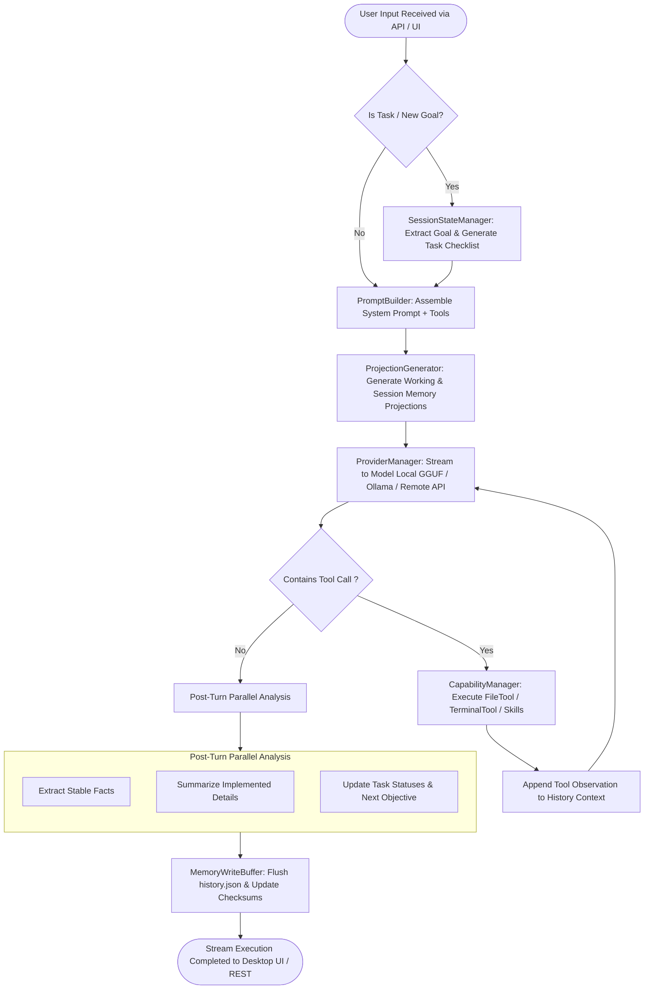
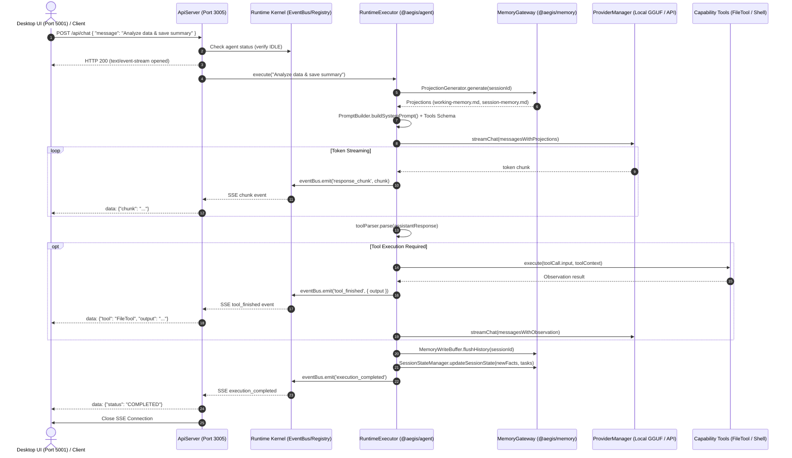
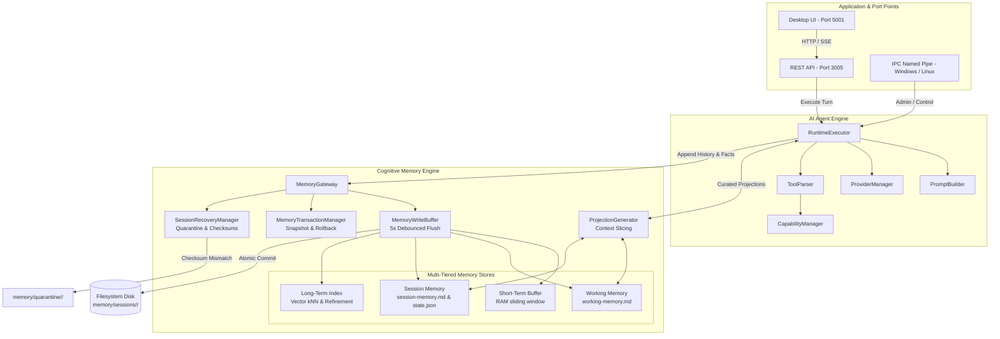

# AEGIS Cognitive Memory & AI Agent Architecture Specification

**Document Version:** 1.0.0  
**Target Systems:** `@aegis/memory`, `@aegis/agent`, `@aegis/runtime`, `@aegis/api`, Desktop UI  
**Last Updated:** October 2026  

---

## 1. Executive Architecture Overview

In the AEGIS operating system, intelligence is split between **Cognitive Memory** (durable, transactional context and semantic retrieval) and the **AI Agent Engine** (autonomous ReAct reasoning, plan orchestration, tool dispatch, and streaming generation).

The system explicitly isolates the Application Layer (Desktop UI, Terminal CLI, and REST gateways) from internal execution through dedicated **network ports, Server-Sent Events (SSE), and OS-level IPC Named Pipes**.

```
┌─────────────────────────────────────────────────────────────────────────────────────────────────┐
│                                APPLICATION LAYER & PORT POINTS                                  │
│                                                                                                 │
│  ┌───────────────────────────┐    ┌───────────────────────────┐    ┌─────────────────────────┐  │
│  │   Desktop UI / Web SPA    │    │      External Clients     │    │   AEGIS CLI / Scripts   │  │
│  │  Browser @ http://127.0.0.1│    │   Python / Dart / SDK     │    │   Terminal / Admin CLI  │  │
│  │       [PORT 5001]         │    │       [PORT 3005]         │    │    [Named Pipe IPC]     │  │
│  └─────────────┬─────────────┘    └─────────────┬─────────────┘    └────────────┬────────────┘  │
└────────────────┼────────────────────────────────┼───────────────────────────────┼───────────────┘
                 │                                │                               │
                 │ HTTP / SSE Stream              │ REST JSON / SSE Stream        │ \\.\pipe\aegis_kernel_v1
                 ▼                                ▼                               ▼
┌─────────────────────────────────────────────────────────────────────────────────────────────────┐
│                           COMMUNICATION BROKER & KERNEL GATEWAY                                 │
│  ┌────────────────────────────────────────────────────────┐ ┌─────────────────────────────────┐ │
│  │        aegis-api Engine (Express / HTTP Server)        │ │   IPC Server (Named Pipe Protocol)│ │
│  │  • POST /api/chat (SSE event-stream)                   │ │   • reloadEngine / startEngine    │ │
│  │  • GET/POST /api/sessions (Checkout, list, trash)      │ │   • node:connect / node:send-msg  │ │
│  │  • GET/POST /api/capabilities (Tool/Skill hot-swaps)   │ │   • status / engineInfo           │ │
│  │  • POST /api/train (LoRA fine-tuning stream)           │ │   • shutdown                      │ │
│  └───────────────────────────┬────────────────────────────┘ └───────────────┬─────────────────┘ │
│                              │                                              │                   │
│                              ▼                                              ▼                   │
│  ┌────────────────────────────────────────────────────────────────────────────────────────────┐ │
│  │                                 ServiceRegistry & EventBus                                 │ │
│  │      `agent`  •  `memoryGateway`  •  `providerManager`  •  `runtimeSessionManager`         │ │
│  └────────────────────────────────────────────┬───────────────────────────────────────────────┘ │
└───────────────────────────────────────────────┼─────────────────────────────────────────────────┘
                                                │
                                                ▼
┌─────────────────────────────────────────────────────────────────────────────────────────────────┐
│                              AI AGENT ENGINE (`@aegis/agent`)                                   │
│                                                                                                 │
│   ┌─────────────────────────────────────────────────────────────────────────────────────────┐   │
│   │                         RuntimeExecutor (Cognitive ReAct Loop)                          │   │
│   │                                                                                         │   │
│   │   1. Turn Initiation ──► Session Checkpoint & Goal/Plan Classifier                      │   │
│   │   2. Prompt Synthesis ──► Combines System Prompt + Tool Schema + Memory Projections     │   │
│   │   3. Model Execution ──► Streams tokens via ProviderManager (GGUF / Ollama / Remote)    │   │
│   │   4. Tool Evaluation ──► Parses `<tool>{...}</tool>` tags & evaluates capabilities      │   │
│   │   5. Turn Finalization ──► Parallel fact extraction, task updates & history commit      │   │
│   └───────────────┬─────────────────────────────────────────────────────────┬───────────────┘   │
│                   │                                                         │                   │
│       Inference & │ Tool Invocation                                         │ Context Retrieval │
│       Generation  ▼                                                         ▼ & Persistence     │
│   ┌───────────────────────────────┐                         ┌───────────────────────────────┐   │
│   │       Capability Ecosystem    │                         │   Memory Projections (curated)│   │
│   │  • FileTool / FolderTool      │                         │   • working-memory.md (short) │   │
│   │  • TerminalTool (shell)       │                         │   • session-memory.md (long)  │   │
│   │  • MemoryTool (direct query)  │                         │   • session-state.json (facts)│   │
│   │  • Skills & Background Plugins│                         │   • task.md (checklist)       │   │
│   └───────────────────────────────┘                         └───────────────┬───────────────┘   │
└─────────────────────────────────────────────────────────────────────────────┼───────────────────┘
                                                                              │
                                                                              ▼
┌─────────────────────────────────────────────────────────────────────────────────────────────────┐
│                         COGNITIVE MEMORY ENGINE (`@aegis/memory`)                               │
│                                                                                                 │
│   ┌─────────────────────────────────────────────────────────────────────────────────────────┐   │
│   │                     MemoryGateway (Primary Multi-Tier I/O Facade)                       │   │
│   └───────────┬─────────────────────────────┬─────────────────────────────┬─────────────────┘   │
│               │                             │                             │                     │
│               ▼                             ▼                             ▼                     │
│   ┌───────────────────────┐   ┌─────────────────────────┐   ┌───────────────────────────────┐   │
│   │   SHORT-TERM MEMORY   │   │    LONG-TERM MEMORY     │   │     TRANSACTIONAL I/O         │   │
│   │                       │   │                         │   │                               │   │
│   │ • In-Memory Queue     │   │ • Hierarchical Vector   │   │ • MemoryWriteBuffer           │   │
│   │   (Sliding Window)    │   │   Index Tree (HNSW/kNN) │   │   (5-sec write coalescing)    │   │
│   │ • Active Working      │   │ • Document & Fact Store │   │ • MemoryTransactionManager    │   │
│   │   Memory Buffer       │   │ • Background Refinement │   │   (ACID journal & rollback)   │   │
│   │ • Per-turn Objectives │   │   & Reflection Engine   │   │ • Integrity Verifier          │   │
│   │   & Tool Context      │   │ • Cross-Session Recall  │   │   (SHA-256 Quarantine system) │   │
│   └───────────┬───────────┘   └─────────────┬───────────┘   └───────────────┬───────────────┘   │
│               │                             │                               │                   │
│               └─────────────────────────────┼───────────────────────────────┘                   │
│                                             ▼                                                   │
│                               ┌───────────────────────────┐                                     │
│                               │ Durable Filesystem Store  │                                     │
│                               │ memory/sessions/<id>/     │                                     │
│                               └───────────────────────────┘                                     │
└─────────────────────────────────────────────────────────────────────────────────────────────────┘
```

---

## 2. Communication Port Points & Interfaces

AEGIS leaves explicit communication port points connecting the Agent and Memory runtimes to the outside world:

| Port / Channel | Protocol | Subsystem Component | Purpose & Payload |
| :--- | :--- | :--- | :--- |
| **`http://127.0.0.1:5001`** | HTTP / Static Web Server | `apps/desktop/main.py` | Hosts the **Desktop UI SPA**, serves local assets, and exposes `/api/gguf/chat` and `/api/gguf/lora/config` for local GGUF models. |
| **`http://127.0.0.1:3005`** | REST HTTP & Server-Sent Events | `packages/aegis-api` (`ApiServer.ts`) | **Primary Agent API Gateway**.<br>• `POST /api/chat`: Real-time SSE token stream.<br>• `GET/POST /api/sessions`: Manage/checkout cognitive sessions.<br>• `GET/POST /api/capabilities`: Dynamic hot-swap of tools, skills, and plugins.<br>• `POST /api/train`: Real-time LoRA fine-tuning stream. |
| **`\\.\pipe\aegis_kernel_v1`** *(Windows)*<br>`/tmp/aegis-ipc.sock` *(POSIX)* | Binary/JSON IPC Named Pipe | `packages/aegis-runtime` (`IpcServer.ts`) | **Subsystem Control Channel**.<br>Used by CLI and background services to hot-reload engines, check health reports, trigger cluster mesh connections (`node:connect`), and monitor system metrics with sub-millisecond overhead. |
| **`http://127.0.0.1:3006`** *(Optional)* | WebSocket | `packages/aegis-runtime` | Bidirectional event bus bridge for real-time telemetry, token streaming, and external node synchronization. |

---

## 3. Cognitive Memory Engine Architecture

The Memory Engine treats memory as a durable, multi-tiered operating system resource rather than flat files. It is broken into three distinct tiers:

### 3.1 Tier 1: Short-Term Memory (Conversation Buffer & Working Memory)
* **Conversation Window Buffer**: Maintained in `historyCache` in RAM. Stores recent message exchanges for the model's sliding token window.
* **Working Memory (`working-memory.md`)**: Contains immediate, per-turn focus data:
  - Current task objective (e.g., *"Extract abnormal blood test values"*).
  - List of currently active tools and skills loaded for this turn.
  - Active sub-task checklists from `task.md`.

### 3.2 Tier 2: Session-Scoped Context
Stored on disk under `memory/sessions/<sessionId>/`:
* **`metadata.json`**: Session lifecycle state (`CREATING`, `ACTIVE`, `TRASH`, `QUARANTINE`), lease duration, timestamps, and cryptographic SHA-256 checksums for every file.
* **`history.json`**: The canonical chronological transcript of user prompts, assistant thoughts, tool calls, and execution observations.
* **`session-state.json`**: Machine-readable JSON tracking long-term goals, active task status tags (`[!]` active, `[✓]` done, `[ ]` pending), and extracted facts.
* **`session-memory.md`**: Human-readable markdown representation of stable facts, patient/user profiles, and persistent instructions.

### 3.3 Tier 3: Long-Term Memory (Hierarchical Vector Index & Reflection)
* **Semantic Vector Index (`indexing/` & `embedding/`)**: Embeds historical text chunks into high-dimensional vector representations. Employs k-Nearest Neighbors (kNN) search to retrieve relevant past experiences across different sessions.
* **Reflection & Refinement Engine (`refinement/`)**: A background service that runs when the write buffer threshold is met:
  1. **Consolidation**: Deduplicates repetitive facts.
  2. **Vector Compression**: Condenses lengthy conversations into concise conceptual summaries.
  3. **Contradiction Resolution**: Detects conflicting statements (e.g., preference overrides) using chronological timestamps.

### 3.4 Transaction Management & Integrity Guarantees
* **`MemoryWriteBuffer` (Write Coalescing)**: Streaming LLM responses append tokens and history items rapidly. Writing to disk on every token ruins I/O performance. The buffer collects writes in RAM and auto-flushes to disk every **5,000 ms** (5 seconds) or immediately at the end of a turn.
* **`MemoryTransactionManager` (ACID Rollbacks)**: Multi-file mutations (e.g., updating history + state + metadata) take a filesystem snapshot before writing. If any step fails, `rollback()` restores the directory to its pristine prior state.
* **Integrity & Quarantine (`recovery/`)**: When loading a session, each file's SHA-256 hash is validated against `metadata.json.checksums`. If tampering or unexpected corruption is detected:
  1. The corrupted session is moved to `memory/quarantine/<sessionId>/`.
  2. Restoration from the last valid snapshot is attempted automatically.
  3. The runtime is protected from crashing or hallucinating on broken state.

---

## 4. AI Agent Engine Execution Architecture

The AI Agent Engine (`@aegis/agent`) operates inside the `RuntimeExecutor` ReAct loop:



### Detailed Agent Turn Steps:
1. **Turn Initiation & Lease Check**: The session is validated via `RuntimeSessionManager`, and a 10-minute non-blocking lease is verified.
2. **Goal & Task Detection**: If the user input assigns work, the LLM classifies objectives and generates an active checklist in `session-state.json`.
3. **Projection Generation**: `ProjectionGenerator` extracts the most relevant markdown from `working-memory.md` and `session-memory.md`, clipping them to token quotas (`maxWorkingMemorySize: 1500 chars`, `maxSessionMemorySize: 1000 chars`).
4. **ReAct Reasoning Loop**:
   - The model streams its response chunk by chunk over SSE to Port 3005 / Port 5001.
   - If the model determines it needs external interaction, it emits a `<tool>{ "name": "...", "input": {...} }</tool>` tag.
   - `ToolParser` extracts the request, evaluates permissions (`fs:read`, `fs:write`, `process:spawn`), executes the tool, and returns the observation directly back into the LLM context.
5. **Post-Turn Memory Extraction**:
   - Three LLM prompts run in parallel: **Fact Extraction**, **Implementation Detail Summarization**, and **Checklist Progress Updating**.
   - Updated stable facts are written to `session-state.json`.
   - `MemoryGateway.flushHistory()` commits conversation history and updates SHA-256 checksums in `metadata.json`.

---

## 5. End-to-End Sequence Diagram



---

## 6. Detailed Memory Subsystem Component Graph



---

## 7. Memory Quotas and Integrity Specification

| Parameter | Default Value | Enforcement Mechanism | Failure Action |
| :--- | :--- | :--- | :--- |
| `maxSessions` | 100 | Checked on `createNewSession()` | Rejects creation with error code `MEM-2001`. |
| `maxHistorySize` | 10 MB (10,485,760 bytes) | Inspected on buffer flush | Emits log warning; prunes oldest conversational turns. |
| `maxWorkingMemorySize`| 1,500 characters | Truncated by `ProjectionGenerator` | Silently clips low-priority metadata from prompt. |
| `maxSessionMemorySize`| 1,000 characters | Truncated by `ProjectionGenerator` | Retains top-weighted stable facts, drops transient notes. |
| `writeBufferDebounce` | 5,000 ms (5 seconds) | Timer managed by `MemoryWriteBuffer` | Forcefully flushed on session checkout or process shutdown. |
| `integrityAlgorithm` | SHA-256 | Validated per file against `metadata.json` | Moves session to `memory/quarantine/` and triggers snapshot restoration. |
