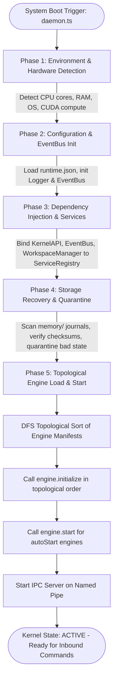

# AEGIS Microkernel Architecture & Internal Structure Specification

**Document Version:** 1.0.0  
**Package:** `@aegis/runtime` (`packages/aegis-runtime`)  
**File Location:** `c:\aegis\docs\aegis_microkernel_structure.md`  
**Last Updated:** October 2026  

---

## 1. Microkernel Architectural Philosophy

In accordance with **ADR-0001 (Adoption of Microkernel Architecture)**, AEGIS is designed so that the core kernel remains ultra-lean, deterministic, and decoupled. 

The microkernel does **not** hardcode business logic, proprietary models, or heavy database algorithms. Instead, it provides the core operating primitives:
1. **Dependency Injection & Service Locator (`Container.ts`, `ServiceRegistry.ts`)**
2. **Topological Engine Lifecycle Supervision (`EngineManager.ts`)**
3. **5-Phase Boot Sequence & System Call Surface (`Bootloader.ts`, `KernelAPI.ts`)**
4. **Strongly-Typed Cross-Subsystem Messaging (`EventBus.ts`)**
5. **Local Control & Inter-Process Communication (`IpcServer.ts`)**
6. **Execution Orchestration & Sandbox Security (`RuntimeExecutor.ts`, `SecurityManager.ts`, `WorkspaceManager.ts`)**

All other capabilities (Memory, AI Models, Distributed P2P Networking, Tools, REST Gateways) plug into the microkernel as decoupled `IEngine` extensions.

---

## 2. Comprehensive Microkernel Internal Blueprint

```
╔═══════════════════════════════════════════════════════════════════════════════════════════════════════════════════╗
║                                        AEGIS MICROKERNEL CORE (`@aegis/runtime`)                                  ║
║                                                                                                                   ║
║  ┌─────────────────────────────────────────────────────────────────────────────────────────────────────────────┐  ║
║  │                                     KERNEL CONTROL & API BOUNDARY                                           │  ║
║  │                                                                                                             │  ║
║  │   ┌──────────────────────────────────────────────┐       ┌──────────────────────────────────────────────┐   │  ║
║  │   │              KernelAPI_v1                    │       │         IpcServer Control Channel            │   │  ║
║  │   │  • Exposed via `IRuntimeContext_v1`          │       │  • Windows: \\.\pipe\aegis_kernel_v1         │   │  ║
║  │   │  • Status: INITIALIZING | ACTIVE | SAFE_MODE │       │  • Linux: /tmp/aegis-ipc.sock                │   │  ║
║  │   │  • resolve(), publishEvent(), shutdown()     │       │  • JSON-RPC: reload, status, engineInfo, etc.│   │  ║
║  │   └──────────────────────┬───────────────────────┘       └──────────────────────┬───────────────────────┘   │  ║
║  └──────────────────────────┼──────────────────────────────────────────────────────┼───────────────────────────┘  ║
║                             │                                                      │                              ║
║                             ▼                                                      ▼                              ║
║  ┌─────────────────────────────────────────────────────────────────────────────────────────────────────────────┐  ║
║  │                                         CENTRAL COORDINATION BUSES                                          │  ║
║  │                                                                                                             │  ║
║  │   ┌──────────────────────────────────────────────┐       ┌──────────────────────────────────────────────┐   │  ║
║  │   │           Typed EventBus Singleton           │       │             ServiceRegistry Locator          │   │  ║
║  │   │  • 100+ strongly-typed event constants       │       │  • Dynamic late-binding of subsystem tokens  │   │  ║
║  │   │  • Sync & async promise error isolation      │       │  • Decouples runtime from memory/agents      │   │  ║
║  │   │  • Structured EventEnvelope<T> standard      │       │  • `register(token, inst)`, `get()`, `has()` │   │  ║
║  │   └──────────────────────┬───────────────────────┘       └──────────────────────┬───────────────────────┘   │  ║
║  └──────────────────────────┼──────────────────────────────────────────────────────┼───────────────────────────┘  ║
║                             │                                                      │                              ║
║                             ▼                                                      ▼                              ║
║  ┌─────────────────────────────────────────────────────────────────────────────────────────────────────────────┐  ║
║  │                                       CORE SUPERVISORY MANAGERS                                             │  ║
║  │                                                                                                             │  ║
║  │   ┌──────────────────────────────────────────────┐       ┌──────────────────────────────────────────────┐   │  ║
║  │   │          Bootloader (5 Phases)               │       │         EngineManager (Supervision)          │   │  ║
║  │   │  Phase 1: Environment & Hardware Detection   │       │  • DFS Topological Sort (Cycle Detection)    │   │  ║
║  │   │  Phase 2: Configuration & Event Bus Init     │       │  • Dynamic Engine Hot-Reloading              │   │  ║
║  │   │  Phase 3: IoC Service Registration           │       │  • Health Probing (status, latency, uptime)  │   │  ║
║  │   │  Phase 4: Storage Recovery & Quarantine      │       │  • Reverse-order Graceful Teardown           │   │  ║
║  │   │  Phase 5: Topological Engine Init & Start    │       │  • Safe Mode Isolation on Fault              │   │  ║
║  │   └──────────────────────────────────────────────┘       └──────────────────────────────────────────────┘   │  ║
║  └──────────────────────────────────────────────────┬──────────────────────────────────────────────────────────┘  ║
║                                                     │                                                             ║
║                                                     ▼                                                             ║
║  ┌─────────────────────────────────────────────────────────────────────────────────────────────────────────────┐  ║
║  │                                        CORE RUNTIME SERVICES & SECURITY                                     │  ║
║  │                                                                                                             │  ║
║  │   ┌───────────────────────────────┐ ┌──────────────────────────────┐ ┌───────────────────────────────────┐  │  ║
║  │   │       RuntimeExecutor         │ │   RuntimeSessionManager      │ │       CapabilityManager           │  │  ║
║  │   │ • ReAct Loop (Think/Act/Obs)  │ │ • Session CRUD & checkouts   │ │ • Dynamic hot-swap of:            │  │  ║
║  │   │ • ToolParser for `<tool>` tags│ │ • 10-Minute Mount Leases     │ │   - Tools (File, Terminal, Mem)   │  │  ║
║  │   │ • Parallel post-turn extractor│ │ • Trashbin & quarantine sync │ │   - Skills, Plugins, Providers    │  │  ║
║  │   └───────────────────────────────┘ └──────────────────────────────┘ └───────────────────────────────────┘  │  ║
║  │   ┌───────────────────────────────┐ ┌──────────────────────────────┐ ┌───────────────────────────────────┐  │  ║
║  │   │       SecurityManager         │ │     WorkspaceManager         │ │     RuntimeHealthValidator        │  │  ║
║  │   │ • Granular permission matrix: │ │ • Sandbox path resolution    │ │ • Heartbeat watchdog checks       │  │  ║
║  │   │   `fs:read`, `fs:write`,      │ │ • Path traversal jail        │ │ • Unhandled crash hooks           │  │  ║
║  │   │   `process:spawn`, `net:*`    │ │   (strict `c:\aegis\` bound) │ │ • State rollback triggers         │  │  ║
║  │   └───────────────────────────────┘ └──────────────────────────────┘ └───────────────────────────────────┘  │  ║
║  └──────────────────────────────────────────────────┬──────────────────────────────────────────────────────────┘  ║
╚═════════════════════════════════════════════════════╪═════════════════════════════════════════════════════════════╝
                                                      │ Pluggable `IEngine` SPI Contracts
                                                      ▼
           ┌──────────────────────┬───────────────────────┬──────────────────────┬─────────────────────┐
           │                      │                       │                      │                     │
           ▼                      ▼                       ▼                      ▼                     ▼
   ┌───────────────┐      ┌───────────────┐       ┌───────────────┐      ┌───────────────┐     ┌───────────────┐
   │ aegis-memory  │      │  aegis-agent  │       │   aegis-api   │      │  distributed- │     │ aegis-train / │
   │ (Priority: 5) │      │ (Priority: 10)│       │ (Priority: 20)│      │ intelligence  │     │ federated /   │
   │ Cognitive Mem │      │ ReAct Agent   │       │ REST & SSE GW │      │ Native C++ DIE│     │ swarm-learning│
   └───────────────┘      └───────────────┘       └───────────────┘      └───────────────┘     └───────────────┘
```

---

## 3. Directory Layout & Subsystem Inventory

Located at [`packages/aegis-runtime/src/`](file:///c:/aegis/packages/aegis-runtime/src):

```
packages/aegis-runtime/src/
├── daemon.ts                          # Bootstrap entrypoint; invokes Bootloader.boot()
├── index.ts                           # Microkernel public export barrel
│
├── boot/                              # Boot Sequence & Core Control Surface
│   └── Bootloader.ts                  # 5-phase startup pipeline, shutdown coordinator, KernelAPI
│
├── managers/                          # Lifecycle & Dynamic Supervision
│   └── EngineManager.ts               # DFS topological sorter, hot-reloader, health monitor
│
├── registry/                          # Service Locator & Registry Recovery
│   ├── ServiceRegistry.ts             # Global IoC Service Locator singleton
│   ├── RuntimeServices.ts             # Well-known service token identifiers
│   ├── RegistryLoader.ts              # Scans engines/ manifests and validates schema
│   └── RegistryRecovery.ts            # Recovers corrupted engine registry caches
│
├── eventbus/                          # Cross-Subsystem Messaging Nervous System
│   ├── EventBus.ts                    # Strongly typed EventEmitter wrapper singleton
│   ├── EventTypes.ts                  # 100+ system event name constants
│   ├── EventRegistry.ts               # Handler registrations and listener metadata
│   └── EventPayloads.ts               # Standardized EventEnvelope<T> definitions
│
├── di/                                # Dependency Injection
│   └── Container.ts                   # Inversion of Control container (bind/resolve)
│
├── transports/                        # Local IPC Communication
│   ├── IpcServer.ts                   # JSON-RPC server listening on Named Pipes
│   ├── IpcPath.ts                     # Cross-platform socket path resolver (Windows/POSIX)
│   └── IpcProtocol.ts                 # Framing, versioning, request/response interfaces
│
├── services/                          # Core Kernel Execution & State Services
│   ├── RuntimeExecutor.ts             # ReAct cognitive execution loop & tool parser
│   ├── RuntimeSessionManager.ts       # Session lifecycle coordinator (create, load, delete)
│   ├── SessionMountManager.ts         # 10-minute session mount lease supervisor
│   ├── SessionStateManager.ts         # Post-turn fact extractor & checklist manager
│   ├── SessionRecoveryManager.ts      # Quarantine manager & checksum auditor
│   ├── CapabilityManager.ts           # Dynamic hot-swapper for Tools, Skills, Plugins
│   ├── SecurityManager.ts             # Capability permission enforcement gate
│   ├── RuntimeHealthValidator.ts      # Watchdog heartbeat and health checker
│   ├── CheckpointManager.ts           # Multi-point state snapshotting
│   └── ToolParser.ts                  # JSON parser for model `<tool>` blocks
│
├── workspace/                         # Filesystem Security
│   └── WorkspaceManager.ts            # Sandboxed absolute path boundary resolver
│
├── config/                            # Configuration Loader
│   └── ConfigurationManager.ts        # Loads and validates runtime.json
│
└── logging/                           # Observability
    └── StructuredLogger.ts            # High-performance structured tagged logger
```

---

## 4. The 5-Phase Microkernel Boot Pipeline

The bootloader ([`Bootloader.ts`](file:///c:/aegis/packages/aegis-runtime/src/boot/Bootloader.ts)) enforces a deterministic 5-phase initialization order. If any critical phase fails, the kernel isolates failing engines and enters `SAFE_MODE`.



### Phase Details:
| Phase | Action | Failure Behavior |
| :--- | :--- | :--- |
| **Phase 1: Environment** | Detects OS platform, CPU architecture, host memory, and NVIDIA CUDA compute drivers. | Halts if host architecture is unsupported. |
| **Phase 2: Config & Bus** | Loads `runtime.json`, resolves paths, initializes `StructuredLogger` and the global `EventBus`. | Reverts to safe fallback defaults. |
| **Phase 3: DI Binding** | Populates `Container` and `ServiceRegistry` with core singletons (`kernelAPI`, `eventBus`, `workspaceManager`). | Halts on IoC collision. |
| **Phase 4: Storage Audit** | Inspects `memory/` directory tree, clears uncommitted transaction journals, and moves corrupted sessions to `memory/quarantine/`. | Isolates corrupted sessions without stopping boot. |
| **Phase 5: Engine Load** | Scans engine manifests (`engine.json`), computes topological order using DFS, calls `initialize()` and `start()`, and binds `IpcServer`. | Enters `SAFE_MODE` if critical dependencies fail (`ENGN-4001`). |

---

## 5. Topological Dependency Sorting & Engine Lifecycles

Engines are decoupled modules implementing `IEngine`. The microkernel resolves startup order via a **Depth-First Search (DFS) Topological Sort**:

```
Engine Dependency Graph:
aegis-memory (priority: 5, deps: [])
    └── aegis-agent (priority: 10, deps: [aegis-memory])
            └── aegis-api (priority: 20, deps: [aegis-agent, aegis-memory])

Startup Order:  aegis-memory ──► aegis-agent ──► aegis-api
Shutdown Order: aegis-api    ──► aegis-agent ──► aegis-memory (Strict Reverse)
```

### `IEngine` State Machine:
```
┌──────────────┐  initialize()  ┌─────────────┐     start()     ┌─────────────┐
│ UNINITIALIZED│ ─────────────► │ INITIALIZED │ ──────────────► │   ACTIVE    │
└──────────────┘                └─────────────┘                 └──────┬──────┘
                                                                       │ pause()
                                                                       ▼
┌──────────────┐  shutdown()    ┌─────────────┐    resume()     ┌─────────────┐
│   STOPPED    │ ◄───────────── │   ONLINE    │ ◄────────────── │   PAUSED    │
└──────────────┘                └─────────────┘                 └─────────────┘
```

---

## 6. The ServiceRegistry Late-Binding Pattern

To prevent circular dependencies between the microkernel and upper engines, the kernel utilizes an **Inversion of Control (IoC) Service Locator**:

```typescript
// Inside aegis-memory (on engine.initialize):
serviceRegistry.register('memoryGateway', memoryGateway);

// Inside aegis-runtime / RuntimeExecutor:
const getMemoryGateway = () => serviceRegistry.get<any>('memoryGateway');
// Resolved lazily at runtime only when a turn executes!
```

This guarantees that `@aegis/runtime` does not have compile-time imports of `@aegis/memory` or `@aegis/agent`, keeping the kernel clean and unbloated.

---

## 7. Security & Capability Enforcement

The microkernel contains a strict security sandbox:
* **`SecurityManager`**: Evaluates permissions declared in each engine's `engine.json`:
  * `fs:read` / `fs:write`: Read and write operations.
  * `process:spawn`: Executing terminal child processes.
  * `net:listen`: Binding network ports (e.g., Port 3005).
  * `network:tcp`: Opening outbound TCP sockets.
* **`WorkspaceManager`**: Sandboxes all file tools to the workspace root (`c:\aegis\workspace\`). Any path attempting `..` traversal outside this directory is intercepted and rejected with an access violation error.
