# AEGIS Comprehensive Single-Node Architecture Specification

**Document Version:** 1.0.0  
**Target Architecture:** Complete Unified AEGIS Node (Layers 1 through 4)  
**File Location:** `c:\aegis\docs\aegis_single_node_architecture.md`  
**Last Updated:** October 2026  

---

## 1. Complete Single-Node Master Blueprint

The diagram below encapsulates the **entire internal structure of an individual AEGIS Node**. It illustrates how all 15 modular engines, the native C++ compute daemon (DIE), the central EventBus, Cognitive Memory, AI Agent reasoning, and hardware resources cooperate inside a single machine boundary.

```
╔══════════════════════════════════════════════════════════════════════════════════════════════════════════════════════════════╗
║                                                     SINGLE AEGIS NODE BOUNDARY                                               ║
║                                                                                                                              ║
║  ┌────────────────────────────────────────────────────────────────────────────────────────────────────────────────────────┐  ║
║  │                                        LAYER 4: APPLICATION & EXTERNAL INGRESS PORTS                                   │  ║
║  │                                                                                                                        │  ║
║  │   ┌─────────────────────────────┐   ┌─────────────────────────────┐   ┌────────────────────────────────────────────┐   │  ║
║  │   │     Desktop UI / SPA        │   │    REST API & SSE Gateway   │   │        IPC Control Channel                 │   │  ║
║  │   │  Browser @ http://127.0.0.1 │   │   HTTP @ http://127.0.0.1   │   │  Windows Named Pipe: \\.\pipe\aegis_kernel │   │  ║
║  │   │       [PORT 5001]           │   │         [PORT 3005]         │   │  POSIX Domain Socket: /tmp/aegis-ipc.sock  │   │  ║
║  │   └──────────────┬──────────────┘   └──────────────┬──────────────┘   └─────────────────────┬──────────────────────┘   │  ║
║  └──────────────────┼─────────────────────────────────┼────────────────────────────────────────┼──────────────────────────┘  ║
║                     │                                 │                                        │                             ║
║                     ▼                                 ▼                                        ▼                             ║
║  ┌────────────────────────────────────────────────────────────────────────────────────────────────────────────────────────┐  ║
║  │                                         LAYER 2 & 3: RUNTIME KERNEL & MODULAR ENGINES                                  │  ║
║  │                                                                                                                        │  ║
║  │  ╔══════════════════════════════════════════════════════════════════════════════════════════════════════════════════╗  │  ║
║  │  ║                                         CENTRAL TYPED EVENT BUS SINGLETON                                        ║  │  ║
║  │  ║                                           (`packages/aegis-runtime/src/eventbus`)                                ║  │  ║
║  │  ╚═══════════════╤═════════════════════════════════╤══════════════════════════════╤═════════════════════════════╤═══╝  │  ║
║  │                  │                                 │                              │                             │      │  ║
║  │                  ▼                                 ▼                              ▼                             ▼      │  ║
║  │  ┌───────────────────────────────┐ ┌──────────────────────────────┐ ┌───────────────────────────┐ ┌──────────────────────┐  │  ║
║  │  │ AI AGENT ENGINE (`aegis-agent`)││   COGNITIVE MEMORY ENGINE    │ │    DISTRIBUTED LEARNING   │ │   CAPABILITY SYSTEM  │  │  ║
║  │  │                               │ │       (`aegis-memory`)       │ │        & TRAINING         │ │   (Dynamic Hot-Swap) │  │  ║
║  │  │ • RuntimeExecutor ReAct Loop  │ │ • MemoryGateway (I/O Facade) │ │ • aegis-training-engine   │ │ • ToolRegistry       │  │  ║
║  │  │   Thought ➔ Action ➔ Observe │ │ • MemoryWriteBuffer (5s Deb.)│ │   (Local LoRA Fine-Tuning) │ │   (File, Terminal,   │  │  ║
║  │  │ • PromptBuilder & Token Cache │ │ • ProjectionGenerator        │ │ • aegis-federated-learning │ │    MemoryTool)       │  │  ║
║  │  │ • Session Goal & Plan Parser  │ │   (Working & Session Views)  │ │   (FedAvg Delta Pooling)   │ │ • SkillRegistry      │  │  ║
║  │  │ • Post-Turn Fact Extraction   │ │ • MemoryTransactionManager   │ │ • aegis-swarm-learning     │ │   (summarize, extract) │  │  ║
║  │  │ • ProviderManager Abstraction │ │   (ACID Journal & Rollback)  │ │   (P2P Consensus Leader)   │ │ • PluginRegistry     │  │  ║
║  │  │   (Local GGUF, Ollama, API)   │ │ • SessionRecoveryManager     │ │ • aegis-data               │ │   (Logging, Telemetry, │  │  ║
║  │  │                               │ │   (SHA-256 Quarantine System)│ │   (Data Ingest & Privacy)  │ │    Auth, Persistence)  │  │  ║
║  │  └───────────────┬───────────────┘ └───────────────┬──────────────┘ └─────────────┬──────────────┘ └──────────┬───────────┘  │  ║
║  │                  │                                 │                              │                           │              │  ║
║  │                  └─────────────────────────────────┼──────────────────────────────┴───────────────────────────┘              │  ║
║  │                                                    │                                                                          │  ║
║  │  ┌─────────────────────────────────────────────────┴─────────────────────────────────────────────────────────────────┐      │  ║
║  │  │                  COLLABORATION, KNOWLEDGE & LIFECYCLE MANAGEMENT ENGINES                                          │      │  ║
║  │  │ • aegis-knowledge-sync (Vector Embeddings & Cluster Doc Sync)  • aegis-collaboration (Multi-Agent Messaging)      │      │  ║
║  │  │ • aegis-collective-intelligence (Multi-Node Swarm Reasoning)   • aegis-package-manager (Atomic .aeg Package Installs)│      │  ║
║  │  │ • aegis-api (REST & SSE Stream Handler)                        • aegis-unified-platform (CLI & UI Dashboard Sync) │      │  ║
║  │  └─────────────────────────────────────────────────┬─────────────────────────────────────────────────────────────────┘      │  ║
║  │                                                    │                                                                          │  ║
║  │  ┌─────────────────────────────────────────────────┴─────────────────────────────────────────────────────────────────┐      │  ║
║  │  │                                          CORE RUNTIME MICROKERNEL SERVICES                                        │      │  ║
║  │  │ • Bootloader (5-Phase Startup) • ServiceRegistry (IoC Locator) • EngineManager (Topological DFS Loader)           │      │  ║
║  │  │ • RuntimeSessionManager (Mount Leases & Lifecycles)            • WorkspaceManager (Sandbox Path Security Enforcer)│      │  ║
║  │  └─────────────────────────────────────────────────┬─────────────────────────────────────────────────────────────────┘      │  ║
║  └────────────────────────────────────────────────────┼────────────────────────────────────────────────────────────────────────┘  ║
║                                                       │                                                                            ║
║                                                       ▼ IPC Channel (Named Pipe / Domain Socket)                                   ║
║  ┌────────────────────────────────────────────────────────────────────────────────────────────────────────────────────────┐  ║
║  │                       LAYER 1: NATIVE C++20 DISTRIBUTED INTELLIGENCE ENGINE — DIE (`die-service.exe`)                  │  ║
║  │                                                                                                                        │  ║
║  │  ┌─────────────────────────────────┐  ┌──────────────────────────────────┐  ┌───────────────────────────────────────┐  │  ║
║  │  │        aegis::dir (DIR)         │  │         aegis::air (AIR)         │  │           aegis::dis (DIS)            │  │  ║
║  │  │  Distributed Intelligence Net   │  │         Native AI Runtime        │  │     Distributed Inference Service     │  │  ║
║  │  │ • Node Discovery & Beacons      │  │ • Native Workflow Orchestrator   │  │ • Inference Session Pool              │  │  ║
║  │  │ • STUN / NAT Hole Punching      │  │ • Agent Lifecycle & Policy Gate  │  │ • High-Speed Token Streaming Pipeline │  │  ║
║  │  │ • Peer Heartbeat Watchdog       │  │ • Native Task Scheduler Adapter  │  │ • Prompt Context Assembler            │  │  ║
║  │  │ • Raw TCP Transport Layer       │  │ • ResultAggregator (Delta Math)  │  │ • Quantized Model Weight Buffer       │  │  ║
║  │  └────────────────┬────────────────┘  └──────────────────────────────────┘  └───────────────────────────────────────┘  │  ║
║  │                   │                                                                                                    │  ║
║  │                   ▼                                                                                                    │  ║
║  │  ┌──────────────────────────────────────────────────────────────────────────────────────────────────────────────────┐  │  ║
║  │  │             HARDWARE TELEMETRY & AON (AEGIS OVERLAY NETWORK) ENCRYPTED MESH ENGINE                               │  │  ║
║  │  │  • ResourceManager: Real-time CPU, RAM, VRAM, and CUDA GPU compute telemetry polling                             │  │  ║
║  │  │  • AON Mesh Transport: Encrypted P2P WireGuard-style ChaCha20-Poly1305 / Noise_IK protocol sockets               │  │  ║
║  │  └────────────────┬─────────────────────────────────────────────────────────────────────────────────────────────────┘  │  ║
║  └───────────────────┼────────────────────────────────────────────────────────────────────────────────────────────────────┘  ║
║                      │                                                                                                       ║
║                      ▼ P2P Encrypted Wire                                                                                    ║
║              [REMOTE AEGIS PEERS]                                                                                            ║
║                                                                                                                              ║
║  ┌────────────────────────────────────────────────────────────────────────────────────────────────────────────────────────┐  ║
║  │                                         LOCAL PHYSICAL PERSISTENCE & STORAGE TIER                                      │  ║
║  │                                                                                                                        │  ║
║  │  ┌───────────────────────────────┐  ┌────────────────────────────────┐  ┌───────────────────────────────────────────┐  │  ║
║  │  │  Cognitive Session Directory  │  │     Quarantine & Recovery      │  │        Weights & Sandboxed Workspaces     │  │  ║
║  │  │     `memory/sessions/<id>/`   │  │      `memory/quarantine/`      │  │   `workspace/` & `.aegis/exports/`        │  │  ║
║  │  │ • metadata.json (SHA-256)     │  │ • Isolated corrupted sessions  │  │ • adapter_model.safetensors (LoRA)        │  │  ║
║  │  │ • history.json (Transcript)   │  │ • Snapshot delta recovery journals│ • Local dataset sharding partitions       │  │  ║
║  │  │ • session-memory.md (Long-Term│  │      `memory/trash/`           │  │ • Engine ZIP packages (`.aeg` archives)   │  │  ║
║  │  │ • working-memory.md (Short-Tm)│  │ • Soft-deleted session records │  │ • GGUF quantized models (`models/`)       │  │  ║
║  │  │ • task.md (Active Checklists) │  │                                │  │                                           │  │  ║
║  │  └───────────────────────────────┘  └────────────────────────────────┘  └───────────────────────────────────────────┘  │  ║
║  └────────────────────────────────────────────────────────────────────────────────────────────────────────────────────────┘  ║
╚══════════════════════════════════════════════════════════════════════════════════════════════════════════════════════════════╝
```

---

## 2. Interactive Mermaid Architecture Flow

The following interactive Mermaid graph details the exact bidirectional relationships, data pipes, and control flows linking all subsystems inside the node:

```mermaid
graph TB
    %% External Interfaces
    subgraph Layer4 [Layer 4: Ingress Endpoints]
        UI["Desktop UI & SPA<br>(Port 5001)"]
        API["REST & SSE Gateway<br>(Port 3005)"]
        IPC_SOCK["IPC Named Pipe<br>(\\.\pipe\aegis_kernel_v1)"]
    end

    %% Layer 2 & 3: Runtime Kernel & Engines
    subgraph Layer2_3 [Layer 2 & 3: Runtime Kernel & Engine Stack]
        EB[("Central EventBus<br>(EventEmitter Singleton)")]
        SR["ServiceRegistry & IoC Locator"]
        
        subgraph AgentSubsystem [AI Agent Subsystem]
            RE["RuntimeExecutor<br>(ReAct Loop)"]
            PB["PromptBuilder & Token Cache"]
            PM["ProviderManager<br>(GGUF / Ollama / Remote)"]
        end

        subgraph MemorySubsystem [Cognitive Memory Subsystem]
            MG["MemoryGateway<br>(Primary I/O Facade)"]
            MWB["MemoryWriteBuffer<br>(5-sec Debounced Flush)"]
            PG["ProjectionGenerator<br>(Context Summarizer)"]
            MTM["MemoryTransactionManager<br>(ACID Snapshots)"]
            SRM["SessionRecoveryManager<br>(Integrity & Quarantine)"]
        end

        subgraph CapabilitiesSubsystem [Pluggable Capabilities]
            CR["CapabilityManager"]
            TR["Tools (File, Terminal, Memory)"]
            SK["Skills (extract, summarize)"]
            PL["Plugins (telemetry, security)"]
        end

        subgraph LearningSubsystem [Distributed Learning Stack]
            TRAIN["aegis-training-engine<br>(LoRA Trainer)"]
            FED["aegis-federated-learning<br>(FedAvg Aggregator)"]
            SWARM["aegis-swarm-learning<br>(Consensus Leader)"]
            DATA["aegis-data<br>(Private Datasets)"]
        end

        subgraph SupportEngines [Platform & Management]
            KS["aegis-knowledge-sync"]
            COL["aegis-collaboration"]
            CI["aegis-collective-intelligence"]
            PKGM["aegis-package-manager"]
        end
    end

    %% Layer 1: Native C++ Engine
    subgraph Layer1 [Layer 1: Native C++20 Distributed Intelligence Runtime - DIE]
        DIE_CORE["DIE Service Daemon<br>(die-service.exe)"]
        DIR["aegis::dir<br>(Discovery, STUN, AON Sockets)"]
        AIR["aegis::air<br>(Workflow Orchestrator, Task Planners)"]
        DIS["aegis::dis<br>(Inference Service, Stream Pools)"]
        RES["ResourceManager<br>(CPU, RAM, VRAM, CUDA)"]
    end

    %% Storage Layer
    subgraph StorageTier [Local Physical Storage Sandbox]
        SESS_DIR[("memory/sessions/<id>/<br>metadata, history, projections")]
        QUAR_DIR[("memory/quarantine/<br>corrupted sessions")]
        WEIGHTS_DIR[("workspace/ & .aegis/exports/<br>safetensors, checkpoints")]
    end

    %% Wiring External to Kernel
    UI -->|HTTP / SSE Stream| API
    API -->|Register SSE Listeners| EB
    API -->|Execute Turn| RE
    IPC_SOCK -->|Low-latency Commands| SR

    %% Wiring Agent Subsystem
    RE <-->|Curated Projections| PG
    RE --> PB
    RE --> PM
    RE --> CR
    CR --> TR
    CR --> SK
    CR --> PL
    RE -->|Events: thinking, chunks, tools| EB

    %% Wiring Memory Subsystem
    RE -->|Commit Turn History| MG
    MG --> MWB
    MG --> MTM
    MG --> SRM
    MWB -->|Coalesced Atomic Write| SESS_DIR
    SRM -->|Integrity Failure| QUAR_DIR
    SRM -->|Restored Snapshot| SESS_DIR
    MG -->|Events: memory.read, corrupted| EB

    %% Wiring Learning Subsystem
    API -->|POST /api/train| TRAIN
    TRAIN --> DATA
    TRAIN -->|Export LoRA| WEIGHTS_DIR
    TRAIN -->|Events: training_progress| EB
    FED -->|Tensor Pooling| WEIGHTS_DIR
    SWARM -->|Consensus Round| EB

    %% Wiring Support Engines
    PKGM -->|Hot-Reload Event| EB
    EB -->|Catch RuntimeRegistryUpdated| SR

    %% Wiring Native DIE Layer
    SR <-->|IPC Socket Protocol| DIE_CORE
    DIE_CORE --> DIR
    DIE_CORE --> AIR
    DIE_CORE --> DIS
    DIE_CORE --> RES
    DIR <-->|Encrypted ChaCha20-Poly1305| REMOTE_PEERS[("Remote Swarm Peers<br>(AON Mesh)")]
```



---

## 3. Subsystem Breakdown Inside a Single Node

### 3.1 Ingress Ports & Gateways
Every AEGIS Node can operate headlessly or with user-facing interfaces:
* **Port `5001` (Desktop UI & SPA)**: Serves the web-based GUI application, system monitor dashboard, and local model inspection controls.
* **Port `3005` (REST API & SSE Gateway)**:
  * `POST /api/chat`: Streams inference chunks and tool execution events via Server-Sent Events.
  * `GET/POST /api/sessions`: Manages session checkouts, metadata, and trashbin operations.
  * `POST /api/train`: Real-time streaming progress of LoRA fine-tuning epochs.
  * `GET/POST /api/capabilities`: Hot-loads or disables tools, skills, and plugins on the fly.
* **IPC Named Pipe (`\\.\pipe\aegis_kernel_v1`)**: Sub-millisecond binary/JSON-RPC channel for daemon control, engine hot-reloading, and low-latency health audits.

---

### 3.2 The Central Nervous System: Global EventBus
The singleton EventBus in [`packages/aegis-runtime/src/eventbus`](file:///c:/aegis/packages/aegis-runtime/src/eventbus) coordinates asynchronous decoupling across all node subsystems:
1. **Agent Events**: `execution_started`, `thinking_started`, `response_chunk`, `tool_started`, `tool_finished`, `execution_completed`.
2. **Memory Events**: `memory.read`, `memory.updated`, `memory.corrupted`, `session.quarantined`, `memory.restored`.
3. **Training Events**: `training_progress`, `training_completed`, `training_error`.
4. **Cluster Mesh Events**: `node:discovered`, `node:connected`, `peer_heartbeat`.
5. **Lifecycle & Registry Events**: `RuntimeRegistryUpdated`, triggering on-the-fly engine manifest reload without process restarts.

---

### 3.3 The AI Agent Reasoning Engine (`@aegis/agent`)
Coordinates cognitive operations inside the node:
* **ReAct Reasoning Loop**: Executes the *Think ➔ Act ➔ Observe* cycle with configurable step limits (`maxReasoningSteps: 5`).
* **PromptBuilder**: Dynamically combines the base instructions, active tools/plugins schema, and curated memory projections into a single token-optimized context.
* **Pluggable Provider Abstraction**: Dispatches requests seamlessly to local quantized GGUF weights, local Ollama daemons, or remote API endpoints.
* **Parallel Post-Turn Analysis**: Upon turn conclusion, runs 3 parallel background tasks to extract permanent facts, summarize completed actions, and update active task checklists.

---

### 3.4 The Cognitive Memory Engine (`@aegis/memory`)
Provides structured, resilient memory persistence:
* **Short-Term Memory**: RAM-cached conversation window and turn-focused `working-memory.md`.
* **Session Memory**: Structured persistent state in `session-memory.md`, `session-state.json`, and `task.md`.
* **Long-Term Semantic Memory**: High-dimensional vector index supporting nearest-neighbor (kNN) context recall across sessions.
* **Write Coalescing (`MemoryWriteBuffer`)**: Defers high-frequency writes during streaming and commits atomically every 5,000 ms.
* **ACID Transactions (`MemoryTransactionManager`)**: Snapshots files before writes; provides complete rollback if any write step fails.
* **Integrity Guard (`SessionRecoveryManager`)**: Computes SHA-256 hashes for every memory file against `metadata.json`. Quarantines corrupted sessions automatically to `memory/quarantine/` and triggers recovery.

---

### 3.5 Distributed Learning & Training Stack
Governs node capabilities during collaborative swarm training:
* **`aegis-training-engine`**: Executes local gradient descent epochs and LoRA fine-tuning using private local data.
* **`aegis-data`**: Cleans, validates, and shards local private datasets while preserving privacy boundaries.
* **`aegis-federated-learning`**: Validates, signs, and executes Federated Averaging (**FedAvg**) tensor pooling when acting as an Aggregator.
* **`aegis-swarm-learning`**: Coordinates dynamic peer-to-peer consensus and per-round leader election algorithms based on node trust, latency, and uptime scores.

---

### 3.6 Native C++20 Distributed Intelligence Engine (DIE)
High-performance background runtime (`die-service.exe`):
* **`aegis::dir` (Distributed Intelligence Runtime)**: Low-level TCP sockets, NAT hole-punching (STUN/ICE), and encrypted AON overlay network tunnels (ChaCha20-Poly1305).
* **`aegis::air` (Native AI Runtime)**: Workflow engine, native task scheduler, and agent policy sandboxing.
* **`aegis::dis` (Distributed Inference Service)**: Manages inference token streaming, prompt assembly, and GPU memory pools.
* **`ResourceManager`**: Live polling of CPU core load, host RAM, VRAM allocations, and CUDA capabilities.

---

## 4. Node Resource & Sandbox Directory Map

Inside the physical filesystem, an individual AEGIS Node strictly confines its mutable state to isolated sandboxes:

```
c:\aegis\
├── memory/
│   ├── sessions/
│   │   └── session_<timestamp>/
│   │       ├── metadata.json       # SHA-256 checksums, lease timestamps, status
│   │       ├── history.json        # Full conversational transcript
│   │       ├── session-state.json  # Extracted facts, active checklist statuses
│   │       ├── session-memory.md   # Long-term semantic knowledge
│   │       ├── working-memory.md   # Per-turn short-term context
│   │       └── task.md             # Active task checklist
│   ├── quarantine/                 # Quarantined corrupted sessions
│   └── trash/                      # Soft-deleted sessions awaiting purge
├── workspace/
│   ├── engines/                    # Deployed modular engines
│   ├── lora/                       # P2P LoRA weight adapters
│   └── logs/                       # Daemon boot and audit logs
├── models/                         # Local GGUF base models and adapters
└── .aegis/
    ├── checkpoints/                # Training run epoch checkpoints
    └── exports/                    # Exported .safetensors LoRA adapters
```
